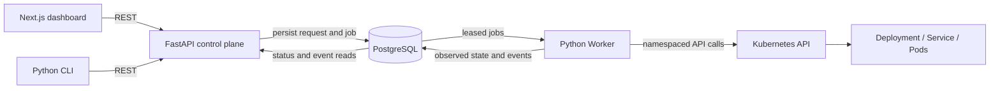

# MiniCloud

MiniCloud is a personal cloud-engineering portfolio project: a self-service
deployment control plane with a REST API, durable background jobs, a Kubernetes
Worker, a developer dashboard, and a Python CLI. It is an educational project,
not a commercial SaaS product or a production-ready platform.

> **Current status: NOT COMPLETE.** The current candidate has not passed a
> real Kubernetes end-to-end deployment using a dedicated least-privilege
> Worker identity. The local demo profile does not start a Worker, so accepted
> deployment requests remain queued. See the [current audit](reports/MINICLOUD-RESUME-MVP-AUDIT.md).

## Features

- FastAPI REST control plane with password hashing, bearer-token revocation,
  project membership, and server-side authorization.
- PostgreSQL persistence with SQLAlchemy and Alembic; deployment jobs,
  revisions, and lifecycle events are stored durably.
- Python polling Worker with leases, retries, failure reporting, Kubernetes
  Deployment/Service reconciliation, and readiness observation.
- Next.js/TypeScript dashboard and Python CLI for project and deployment
  workflows, scaling, revision history, rollback, and bounded diagnostics.
- Namespace-scoped Kubernetes RBAC manifests and non-root container
  configurations.

`202 Accepted` means a request was persisted, not that Kubernetes has made a
workload ready. The Worker is designed to report readiness only after observing
the requested Kubernetes state.

## Architecture



PostgreSQL is also the durable job store; there is no separate message broker.
The Web console and CLI use the API rather than connecting directly to the
database or Kubernetes.

## Technology and repository structure

Python, FastAPI, SQLAlchemy, Alembic, PostgreSQL, Kubernetes Python client,
Next.js, React, TypeScript, Docker Compose, pytest, Ruff, Playwright, and
GitHub Actions.

```text
apps/web/                 Next.js dashboard
services/api/             FastAPI control plane and migrations
services/worker/          PostgreSQL-backed polling Worker
packages/minicloud_cli/   Python CLI
infra/docker/             Container build files and demo gateway
infra/kubernetes/         Namespace-scoped RBAC manifest
scripts/                  Integration and operational utilities
docs/                     Setup, architecture, API, CLI, operations
reports/                  Current audit, test evidence, resume entry
```

## Prerequisites

- Python 3.12 (the CI target); Python 3.14 was used for the last reported
  backend test run.
- Node.js 22 and npm 11 for Web development.
- Docker Desktop with Linux containers and Docker Compose v2 for the
  disposable API/Web demo.
- kubectl and kind only for a separately approved isolated Kubernetes test.

See [setup](docs/SETUP.md) and [troubleshooting](docs/TROUBLESHOOTING.md).
The repository includes no credentials; `.env.example` contains placeholders
only. Keep generated credentials in ignored local files.

## Disposable local API and Web demo

The documented demo uses `docker-compose.demo.yml`, ephemeral PostgreSQL
storage, loopback-only ports, and unique demo image names. It does not start a
Worker or Kubernetes cluster. Do not describe this profile as a successful
Kubernetes deployment.

After confirming Docker is available and the demo ports are free:

```powershell
$env:MINICLOUD_DEMO_JWT_SECRET = (& python -c "import secrets; print(secrets.token_hex(32))")
docker compose --project-name minicloud-resume-demo --file docker-compose.demo.yml --profile migration run --build --rm migrate
docker compose --project-name minicloud-resume-demo --file docker-compose.demo.yml up --build -d api web gateway
```

Open `http://127.0.0.1:13018`. A deployment accepted in this profile remains
queued because no Worker is started. The profile's startup has not been
runtime-verified in the latest assessment; see the [demo guide](docs/DEMO.md).

To shut down only this named demo project:

```powershell
docker compose --project-name minicloud-resume-demo --file docker-compose.demo.yml down
Remove-Item Env:\MINICLOUD_DEMO_JWT_SECRET
```

The main `docker-compose.yml` is not the documented disposable demo. Review
its resource references before using it; do not run it against an environment
containing data or services you need to preserve.

## API and CLI

The API is versioned under `/api/v1`; FastAPI OpenAPI documentation is served
at `/docs` when the API is running. See the [API reference](docs/API.md) for
routes, pagination, authentication, and asynchronous deployment semantics.

The CLI can be invoked from the repository root:

```powershell
python -m packages.minicloud_cli.cli --help
python -m packages.minicloud_cli.cli register --email developer@example.test
$env:MINICLOUD_EMAIL = "developer@example.test"
python -m packages.minicloud_cli.cli project list --limit 50
```

Authenticated commands prompt for a password and keep access tokens in memory.
The [CLI guide](docs/CLI.md) documents deployment, status/watch, scaling,
rollback, events, and diagnostics.

## Docker and Kubernetes

API, Worker, and Web Dockerfiles are under `infra/docker/`. The isolated demo
Compose file is intended for API/Web exploration only. Kubernetes objects are
generated by the Worker; the source RBAC manifest is
`infra/kubernetes/namespace-rbac.yaml`. It has not been applied to a current
candidate cluster in this assessment.

The current-candidate least-privilege Kubernetes E2E—including Ready status,
scale, rollback, diagnostics, and negative authorization checks—remains
unverified. Do not use an administrator kubeconfig as Worker evidence. See the
[Kubernetes guide](docs/KUBERNETES.md) and [deployment notes](docs/DEPLOYMENT.md).

## Testing

From the repository root:

```powershell
python -m pytest services\api\tests -q
python -m ruff check services\api\app services\api\tests services\api\integration_tests services\worker packages\minicloud_cli
pip-audit --strict -r services\api\requirements.txt
```

For Web checks, from `apps/web`:

```powershell
npm ci
npm run lint
npm run typecheck
npm run test:e2e
npm run build
npm audit --audit-level=moderate
```

The Playwright test uses a mocked API. It is not a backend/Worker/Kubernetes
end-to-end test. Current and historical test evidence are distinguished in
the [test evidence report](reports/MC-FINAL-TEST-EVIDENCE.md).

## Security and limitations

Passwords are hashed; project authorization is checked server-side; database
roles are separated; containers use non-root users; diagnostics use a separate
read-only identity; and Kubernetes RBAC source is namespace-scoped. These
controls do not establish production readiness or hostile-tenant isolation.

Known gaps include:

- No verified current-candidate Kubernetes deployment with least-privilege
  Worker credentials.
- No live Kubernetes readiness, scale, rollback, or diagnostics proof for
  that candidate.
- No Kubernetes Namespace/ResourceQuota/LimitRange reconciler.
- The disposable demo has no Worker and leaves deployments queued.
- The browser test is mocked; no genuine deployment screenshots or demo video
  are available.
- Docker runtime and GitHub Actions execution were not verified in the latest
  assessment.

See [security notes](docs/SECURITY.md), [testing status](docs/TESTING.md),
and the [current audit](reports/MINICLOUD-RESUME-MVP-AUDIT.md). Do not use
this project for untrusted public workloads.

## Resume summary

MiniCloud demonstrates a cloud-native deployment control plane using
FastAPI, PostgreSQL, a durable Python Worker, Kubernetes reconciliation,
Next.js/TypeScript, and a Python CLI. Implemented workflows include
authenticated project management, deployment submission, lifecycle tracking,
replica scaling, revision history, and rollback. Current-candidate
least-privilege Kubernetes E2E remains pending. See the
[resume entry and interview notes](reports/MINICLOUD-RESUME-ENTRY.md).

## Screenshots and license

No screenshots of a successful current-candidate Kubernetes deployment are
included. The repository does not currently specify a project license.
