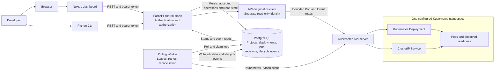
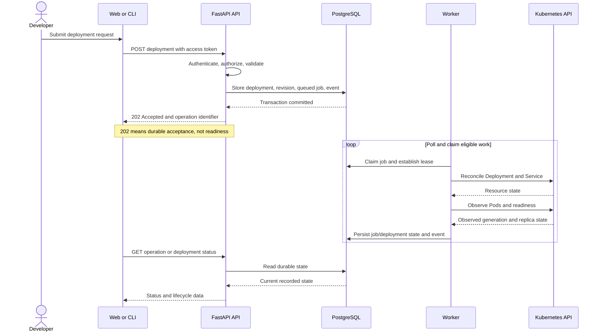
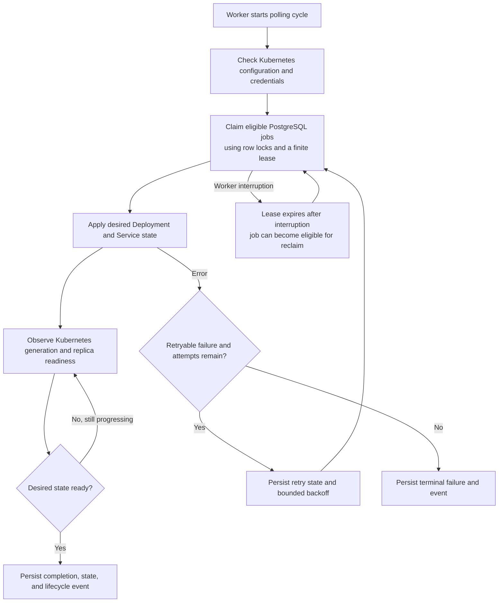
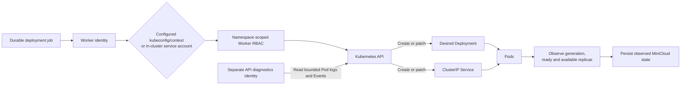

# MiniCloud

**A small deployment control plane, built around durable requests and observed state.**

MiniCloud is a portfolio-scale platform for submitting container deployment,
scale, and rollback requests through an authenticated API, Python CLI, and web
console. A separate polling Worker stores job progress in PostgreSQL and
reconciles Kubernetes resources; this repository is an engineering project,
not a hosted cloud service or production-ready multi-tenant platform.

[](https://github.com/amaan-mansoori/MiniCloud/actions/workflows/ci.yml)
[](https://www.python.org/)
[](https://nodejs.org/)
[](https://fastapi.tiangolo.com/)
[](https://nextjs.org/)
[](https://kubernetes.io/)

**Project status: NOT COMPLETE.** The API, Worker, CLI, dashboard, and
Kubernetes adapter are implemented and have automated coverage. A current
candidate has not passed the dedicated least-privilege Kubernetes end-to-end
verification described below. MiniCloud makes no production-readiness or
hostile-tenant-isolation claim.

- [Architecture](docs/ARCHITECTURE.md) | [Local setup](docs/SETUP.md) |
  [API reference](docs/API.md) | [Testing](docs/TESTING.md)
- [Security model](docs/SECURITY.md) | [Kubernetes](docs/KUBERNETES.md) |
  [Current audit](reports/MINICLOUD-RESUME-MVP-AUDIT.md)

## What MiniCloud is

A deployment control plane accepts a desired workload from a developer,
records that request durably, and reports what an execution component later
observes. MiniCloud explores those boundaries in a modular monolith: the API
owns authentication, authorization, validation, and durable acceptance; a
separate Worker claims jobs and applies desired state to Kubernetes.

Developers interact through the FastAPI REST API, a Python CLI, or a Next.js
dashboard. PostgreSQL stores projects, memberships, deployments, desired-state
revisions, jobs, and lifecycle events. The Worker polls PostgreSQL directly;
there is no message broker. The repository is intended for local engineering,
testing, and portfolio discussion, not as a managed cloud offering.

## Capabilities and evidence

The status labels distinguish code and test coverage from successful
verification against a live Kubernetes cluster.

| Area | Status | What is present |
|---|---|---|
| Control plane | **Implemented** | Versioned FastAPI routes, request validation, request IDs, health/readiness endpoints, and capability reporting. |
| Users and projects | **Implemented** | Registration/login, project membership roles, project-scoped authorization, and cursor-paginated project/deployment reads. |
| Durable operations | **Implemented; PostgreSQL integration-tested** | Deployment, scale, and rollback acceptance stores jobs, revisions, and initial events transactionally before returning HTTP 202. |
| Worker processing | **Implemented; automated tests** | PostgreSQL job polling/claiming, finite leases, bounded retries, failure reporting, and lifecycle-event persistence. A successful current-candidate Kubernetes job is pending verification. |
| Kubernetes workloads | **Implemented; live verification pending** | Worker adapter reconciles a Deployment and ClusterIP Service in one configured namespace and observes Pod readiness. |
| Scale and rollback | **Implemented; live convergence pending** | Version-checked scale requests and revision-based rollback create durable operations; current-candidate Ready/scale/rollback convergence has not been demonstrated. |
| Diagnostics | **Implemented; live retrieval pending** | Bounded, redacted Pod logs and filtered Kubernetes Events use a separate API diagnostics identity. |
| Resource policy | **Partially implemented** | Project policy is persisted and checked at API admission. Namespace, ResourceQuota, and LimitRange reconciliation is not implemented; policy can remain `pending`. |
| Web console | **Implemented; browser test is mocked** | Project, deployment, membership, policy, revision, event, and diagnostics views use the API. The Playwright API is mocked; this is not live Kubernetes evidence. |
| Python CLI | **Implemented** | Authenticated project, deployment, scaling, revision, rollback, event, and diagnostics commands. |
| Security boundaries | **Implemented in source; not a production certification** | Password hashing, revocable access tokens, project authorization, separated database roles, and namespace-scoped Worker RBAC are present. |
| Operational visibility | **Partial** | Request IDs and persisted lifecycle events exist. Metrics and alert delivery are unavailable. |

## Architecture



The API is the synchronous boundary for authentication, project authorization,
validation, and database transactions. A successful submission is committed
before the API responds. PostgreSQL is the durable source of truth for
MiniCloud's requested operations and recorded lifecycle state; Kubernetes is
the system against which the Worker reconciles and observes workloads.

The Worker polls PostgreSQL rather than receiving broker messages. It claims
eligible rows under a lease, applies desired state using the Kubernetes
Python client, observes the resulting workload, and persists progress and
events. The dashboard and CLI read operation state from the API; they do not
talk directly to the Worker or Kubernetes. Live diagnostics are an exception:
the API uses its separately configured read-only diagnostics identity to make
bounded Kubernetes reads.

### Deployment request lifecycle



HTTP `202 Accepted` means the request was durably accepted. It does not mean
that a Pod is ready or that a deployment succeeded. The Worker records
`queued`, `applying`, `progressing`, `timed_out`, `completed`, or `failed`
job states as the operation proceeds; the deployment becomes `ready` only
after observation satisfies the desired generation and replica conditions.
`timed_out` is an observation state, not proof that Kubernetes stopped the
workload.

### Worker job processing



Job claims use PostgreSQL row locking (`FOR UPDATE SKIP LOCKED`) and finite
leases; retry attempts are bounded. This is recoverable, at-least-once style
processing, not an exactly-once guarantee. Kubernetes authentication failures
pause processing without consuming the retry budget. Missing or invalid
Worker configuration is reported rather than replaced with a simulated
success. See [Worker operations](docs/WORKER.md) and
[reliability objectives](docs/operations/RELIABILITY_OBJECTIVES.md).

### Kubernetes resource reconciliation



The adapter works in one configured namespace; it does not provision a
namespace per project. The source RBAC manifest is narrower than cluster
administrator access, but manifest inspection is not proof that a live
current-candidate Worker ran with that identity. Diagnostics use a separate
identity. See [Kubernetes architecture and deployment](docs/KUBERNETES.md)
and [Worker credentials](docs/runbooks/worker-credentials.md).

## Components

| Component | Responsibility | Technology | Communication |
|---|---|---|---|
| API | Authentication, authorization, validation, durable acceptance, reads | Python, FastAPI, SQLAlchemy | REST/JSON with clients; SQL with PostgreSQL |
| PostgreSQL | Durable projects, deployments, jobs, revisions, events, and token revocations | PostgreSQL 16, Psycopg 3 | API and Worker database sessions |
| Worker | Poll, lease, retry, reconcile, observe, and record operation progress | Python, SQLAlchemy, Kubernetes Python client | PostgreSQL polling and Kubernetes API |
| Dashboard | Browser interface to project and deployment operations | Next.js, React, TypeScript | API calls; no direct database or Kubernetes access |
| CLI | Scriptable project and deployment operations | Python package, `argparse` | API calls using bearer tokens held in memory |
| Kubernetes | Run the requested workload and expose observed resource state | Kubernetes Deployment, Service, Pods | Worker reconciliation; separate API diagnostics reads |

## Technology stack

| Area | Technologies and verified versions |
|---|---|
| Backend | Python 3.12 in CI and container images; FastAPI 0.143.0; Pydantic 2.11.7; SQLAlchemy 2.0.41; Alembic 1.16.2 |
| Persistence | PostgreSQL 16; Psycopg 3.2.13; SQLAlchemy ORM; Alembic migrations |
| Kubernetes | Kubernetes Python client 35.0.0; Kubernetes API; namespace-scoped Deployment and Service permissions |
| Frontend | Node.js 22 in CI; Next.js 16.4.3; React 19.0.0; TypeScript 5.8.3; Tailwind CSS 4.3.3 |
| Containerization | Docker Engine/Desktop with Linux containers; Docker Compose; separate API, Worker, Web, and disposable-demo configuration |
| Testing and quality | pytest 9.0.3; Ruff 0.16.7; Playwright; PostgreSQL integration scripts; YAML and Compose validation |
| CI/CD | GitHub Actions; backend checks, disposable database/retention integrations, container builds, and frontend quality checks |

Exact dependency pins and supported local setup are maintained in
[API requirements](services/api/requirements.txt),
[Web package metadata](apps/web/package.json), and
[Local setup](docs/SETUP.md).

## Security boundaries

- **Passwords and tokens:** passwords are hashed with Argon2. Access tokens
  are HS256 signed and revocable; token fingerprints are persisted for
  revocation checks. The CLI prompts for passwords and keeps access tokens in
  memory. Refresh-token rotation is not implemented.
- **Project authorization:** project membership roles are checked server-side
  for project and deployment operations. Owner-only actions include membership
  and resource-policy changes. This is application authorization, not
  hostile-tenant isolation.
- **Database identities:** API, Worker, and migration connections have
  separate database roles in the intended configuration. The disposable
  PostgreSQL integration validates database grants; local demo credentials
  are not a production secret-management design.
- **Kubernetes identities:** the Worker RBAC manifest is namespace-scoped.
  The diagnostics identity is separate and read-only for bounded Pod/Event
  reads, including `pods/log`. Source review does not validate the live
  identity or cluster policy.
- **Containers and configuration:** API and Worker containers run as
  non-root users with hardened container settings. Secrets are supplied
  through environment-based configuration; keep local secret files ignored
  and never put credentials in logs, screenshots, or commits.
- **Diagnostics:** Kubernetes log and Event reads are bounded and apply
  common-pattern redaction. Redaction is not a guarantee that arbitrary
  application output contains no sensitive information.

There is no claim of production-grade security, per-project namespace
isolation, network-policy isolation, or a certified threat model. See
[Security](docs/SECURITY.md) for the controls and open gaps.

> [!WARNING]
> MiniCloud is an educational and development project, not a production-ready
> deployment platform. Do not expose it to untrusted public workloads or use
> it as a production multi-tenant service. Namespace-scoped controls do not
> establish complete hostile-tenant isolation. Production use would require a
> separate security review and threat model, additional hardening, and
> verified least-privilege execution.

## Repository map

```text
MiniCloud/
├── apps/web/                 Next.js dashboard, API client, mocked browser tests
├── services/api/             FastAPI app, domain modules, migrations, API tests
├── services/worker/          PostgreSQL polling and Kubernetes reconciliation
├── packages/minicloud_cli/   Python CLI package
├── infra/docker/             Docker-related configuration
├── infra/kubernetes/         Namespace-scoped manifests and RBAC
├── scripts/                  Local validation and disposable integration scripts
├── docs/
│   ├── adr/                  Architecture decision records
│   ├── operations/           Operational objectives and procedures
│   └── runbooks/             Backup, restore, credentials, and recovery guidance
├── reports/                  Audits, test evidence, and project status
├── .github/workflows/        CI workflow
├── docker-compose.yml        Main persistent/local integration configuration
├── docker-compose.demo.yml   Isolated API/Web demo; no Worker
└── README.md
```

The main Compose configuration is not the disposable demo: it uses persistent
database storage and shared local infrastructure settings. Review
[Local setup](docs/SETUP.md) and [backup/restore](docs/runbooks/backup-restore.md)
before running operational commands. Do not use global Docker cleanup
commands or remove volumes to resolve setup issues.

## Local development

### Prerequisites

- Windows with Docker Desktop using Linux containers and Docker Compose.
- Python 3.12 for the CI-matched backend environment.
- Node.js 22 and npm for the Web application.
- Free loopback ports 13018 and 18017 for the isolated demo.

The setup below starts an **API/Web demo only**. It uses a disposable
PostgreSQL instance with tmpfs storage, publishes only loopback gateway ports,
does not start a Worker, and does not access Kubernetes. Consequently,
deployment requests stay queued; this profile is not evidence of a successful
Kubernetes deployment.

From PowerShell at the repository root:

```powershell
$env:MINICLOUD_DEMO_JWT_SECRET = (& python -c "import secrets; print(secrets.token_hex(32))")
docker compose --project-name minicloud-resume-demo --file docker-compose.demo.yml --profile migration run --build --rm migrate
docker compose --project-name minicloud-resume-demo --file docker-compose.demo.yml up --build -d api web gateway
```

Open [http://127.0.0.1:13018](http://127.0.0.1:13018). The API gateway is
available at `http://127.0.0.1:18017`. The demo is for disposable local data;
do not enter real credentials or sensitive information. Its scoped shutdown
and data-safety cautions are documented in
[Local setup](docs/SETUP.md#disposable-api-and-web-demo). Do not add
`--volumes`, prune Docker resources, or substitute the main Compose project.

Install backend dependencies and run the focused API suite:

```powershell
python -m venv .venv
.\.venv\Scripts\python.exe -m pip install -r services\api\requirements.txt
.\.venv\Scripts\python.exe -m pytest services\api\tests -q
```

For frontend development and its mocked browser suite:

```powershell
Set-Location apps\web
npm ci
npx playwright install chromium
npm run lint
npm run typecheck
npm run test:e2e
npm run build
```

Full Docker, PostgreSQL, Kubernetes, and test-environment setup details are in
[SETUP.md](docs/SETUP.md) and [TESTING.md](docs/TESTING.md). Do not run
Kubernetes integration tests against a shared or production cluster; they
require an explicitly configured disposable test environment.

## Configuration

The API and Worker read settings from the environment (and a local `.env`,
when present). Use distinct database roles for API, Worker, and migration
processes, and supply strong secrets outside source control.

| Component | Settings to configure |
|---|---|
| API | `DATABASE_URL`, `SERVICE_ROLE=api`, `JWT_SECRET_KEY`, `APP_ENV`, and `CORS_ORIGINS` |
| Migrations | `DATABASE_URL`, `SERVICE_ROLE=migrate`, and a separate `MIGRATION_DATABASE_URL` |
| Worker | Worker-role `DATABASE_URL`, `SERVICE_ROLE=worker`, `KUBERNETES_NAMESPACE`, and either in-cluster credentials or explicit `KUBERNETES_CONFIG_FILE` plus `KUBERNETES_CONTEXT` |
| API diagnostics | Separate diagnostics identity via in-cluster configuration or `KUBERNETES_DIAGNOSTICS_CONFIG_FILE` plus `KUBERNETES_DIAGNOSTICS_CONTEXT` |
| Web and CLI | Web API origin `NEXT_PUBLIC_API_URL`; CLI `MINICLOUD_API_URL` and, for authenticated commands, `MINICLOUD_EMAIL` |
| Isolated demo | A unique disposable `MINICLOUD_DEMO_JWT_SECRET`; the demo Compose file maps it to the API signing-key setting |

The demo secret must be at least 32 characters and should be generated
randomly for each disposable run. Do not copy production credentials into a
local `.env`, the demo, logs, or issue reports. Configuration defaults,
validation, and database-role requirements are documented in
[SETUP.md](docs/SETUP.md) and [SECURITY.md](docs/SECURITY.md).

## API

The API is versioned under `/api/v1`. Protected routes use
`Authorization: Bearer <access-token>`. Every response includes a
server-generated `X-Request-ID`. Errors currently use FastAPI `detail`
responses; a universal error envelope is not implemented.

| Route group | Examples |
|---|---|
| Authentication | `/api/v1/auth/register`, `/login`, `/me`, `/logout` |
| Projects and membership | `/api/v1/projects`, `/api/v1/projects/{project_id}/members` |
| Policy | `/api/v1/projects/{project_id}/quota` |
| Deployments and operations | `/api/v1/projects/{project_id}/deployments`, `/api/v1/operations/{deployment_id}` |
| Scale, revisions, rollback | Deployment `scale`, `revisions`, and `rollback` routes |
| Events and diagnostics | Deployment `events`, `logs`, and `kubernetes-events` routes |
| Health and capability | `/health`, `/livez`, `/readyz`, `/api/v1/capabilities` |

Example deployment submission (replace the project ID and token):

```http
POST /api/v1/projects/{project_id}/deployments
Authorization: Bearer <access-token>
Content-Type: application/json

{
  "name": "web",
  "image": "nginx:1.27-alpine",
  "port": 80,
  "replicas": 1,
  "idempotency_key": "web-first-deploy"
}
```

The request is validated and persisted with its revision and queued job before
the API returns `202 Accepted`. Poll the operation or deployment endpoint to
observe progress; `202` is not a success or readiness response. Full request
schemas, authorization, conflict behavior, and pagination are in the
[API reference](docs/API.md).

## Python CLI

Run the CLI from the repository root. Set `MINICLOUD_API_URL` or pass
`--api-url`; authenticated commands prompt for a password and keep the token
in memory. A non-loopback API URL must use HTTPS.

```powershell
$env:MINICLOUD_API_URL = "http://127.0.0.1:18017"
python -m packages.minicloud_cli.cli register --email developer@example.test
$env:MINICLOUD_EMAIL = "developer@example.test"
python -m packages.minicloud_cli.cli platform capabilities
python -m packages.minicloud_cli.cli project list --limit 50
python -m packages.minicloud_cli.cli deploy list --project-id <project-id> --limit 50
python -m packages.minicloud_cli.cli deploy status --deployment-id <deployment-id>
```

`deploy create` and `deploy scale` wait for the operation and exit successfully
only after `ready`; rollback waits on the normal readiness-observation path.
In the Worker-free demo those operations cannot converge and must not be
presented as successful Kubernetes deployments. The CLI also exposes project
membership, revisions, lifecycle events, and bounded Kubernetes diagnostics.
See the [CLI guide](docs/CLI.md) for commands, pagination, and exit behavior.

## Kubernetes integration

The Worker uses the Kubernetes Python client and an explicit kubeconfig/context
or an in-cluster service account. It reconciles a Deployment and ClusterIP
Service in one configured namespace, then observes the desired generation and
available replicas before MiniCloud records `ready`. The API does not create a
namespace per project.

`infra/kubernetes/namespace-rbac.yaml` contains the Worker and separate
diagnostics service-account/RBAC definitions. The API diagnostics endpoints
require the diagnostics identity and return an explicit unavailable response
when diagnostics cannot be performed; they do not silently substitute empty
or simulated data.

Scale and rollback operations use the regular reconcile-and-observe path.
Their API, persistence, CLI, and adapter behavior has automated coverage, but
the current candidate has not completed least-privilege live Kubernetes
verification for Ready, scale, rollback, diagnostics, and negative
authorization. A successful run with an administrator kubeconfig is not
evidence of least-privilege Worker behavior. Project policy admission is
implemented, but Kubernetes `Namespace`, `ResourceQuota`, and `LimitRange`
reconciliation is not.

## Testing and CI

The checks cover different boundaries; they are not interchangeable:

| Test category | What it establishes | What it does not establish |
|---|---|---|
| Backend unit/API tests | Validation, authorization, persistence, and operation behavior under the test database/configuration | A live Kubernetes deployment |
| Worker tests | Job claiming, leases, retries, error handling, adapter interactions | Current-candidate cluster behavior |
| Disposable PostgreSQL integration | Real PostgreSQL schema, roles, constraints, and transaction behavior in an isolated database | Production database safety or Kubernetes behavior |
| PowerShell fixture tests | Backup-retention selection and isolated archive/metadata behavior; Docker-backed archive checks run in CI | Safety of real backup directories |
| Kubernetes tests | Source/adapter behavior; the opt-in cluster test requires an explicitly configured disposable cluster | Default CI is not a current-candidate least-privilege E2E |
| Web Playwright tests | Browser behavior against a mocked API | Live API, Worker, or Kubernetes integration |
| Genuine end-to-end deployment test | Not yet completed for the current candidate | No Ready/scale/rollback/diagnostics claim can be made from mocked or historical evidence |

The GitHub Actions run
[43579415390](https://github.com/amaan-mansoori/MiniCloud/actions/runs/43579415390)
completed successfully on published commit
`02145ebe50444e0e68f9cffe21998b51dc6b4a37`. It covered the configured backend
checks, Ruff, disposable PostgreSQL and backup-retention integrations,
Compose validation, image builds, and frontend quality checks. That run does
not verify a live Kubernetes cluster or a different, uncommitted working
tree.

The retained local test-evidence report recorded 176 backend/API/CLI tests
passing, one opt-in Kubernetes test skipped, and two warnings under Python
3.14.3. CI targets Python 3.12; the local run is not a Python-version
compatibility matrix. See [test evidence](reports/MC-FINAL-TEST-EVIDENCE.md),
[CI workflow](.github/workflows/ci.yml), and
[testing guide](docs/TESTING.md) for scope and limitations.

## Reliability and failure handling

- Deployment, scale, and rollback requests are persisted before acceptance;
  PostgreSQL is the durable job and MiniCloud-state store.
- Worker claims use row locks and finite leases. An expired lease can make
  work eligible for reclaim after interruption.
- Retryable failures use bounded retries and backoff. Terminal errors are
  recorded rather than returned as success-shaped fallbacks.
- Kubernetes readiness is observed before `ready` is persisted. An accepted
  operation can remain queued, progressing, or time out without becoming
  ready.
- Lifecycle events and request IDs support operation tracing, but request IDs
  are not attached to Kubernetes resource metadata.
- Processing is not exactly once. Duplicate apply attempts and the
  consistency boundary between PostgreSQL and Kubernetes remain operational
  concerns; no distributed transaction spans both systems.
- Metrics and alert delivery are currently unavailable. Reliability targets
  are documented, not claimed as achieved.

See [Worker operations](docs/WORKER.md),
[reliability objectives](docs/operations/RELIABILITY_OBJECTIVES.md), and the
[backup/restore runbook](docs/runbooks/backup-restore.md).

## Current status and known limitations

The current audit is **NOT COMPLETE**. The project implements meaningful
control-plane and Worker paths, but implementation and unit tests do not by
themselves establish successful operation in a current Kubernetes candidate.

| Requirement | Current evidence |
|---|---|
| Current-candidate Kubernetes E2E with a dedicated least-privilege Worker identity | **Pending verification.** Historical Ready evidence used administrator credentials and is not equivalent. |
| Live Ready, scale, rollback, diagnostics, and negative-authorization checks | **Pending verification** against the current candidate and approved disposable cluster. |
| Per-project namespace, ResourceQuota, and LimitRange reconciliation | **Not implemented.** API-level resource-policy checks are not a Kubernetes backstop. |
| Worker in the disposable API/Web demo | **Unavailable by design.** Demo starts no Worker; deployment jobs remain queued. |
| Runtime verification of the full disposable demo | **Not established** by the available local evidence. |
| Genuine screenshots or video of successful deployment workflows | **Unavailable.** No genuine deployment screenshots or recording are checked in. |
| Production readiness and hostile-tenant isolation | **Not established and not claimed.** |
| Metrics and alert delivery | **Unavailable.** |
| License | **No license file found.** Reuse and redistribution rights are not specified by this repository. |

The source and evidence reviewed for this status are summarized in
[MINICLOUD-RESUME-MVP-AUDIT.md](reports/MINICLOUD-RESUME-MVP-AUDIT.md) and
[MC-FINAL-TEST-EVIDENCE.md](reports/MC-FINAL-TEST-EVIDENCE.md).

## Roadmap

- **Implemented:** durable API acceptance, project authorization, PostgreSQL
  job processing, CLI and dashboard interfaces, and Kubernetes adapter.
- **Implemented; integration-tested:** disposable PostgreSQL schema/role and
  backup-retention flows in CI.
- **Pending verification:** current-candidate, dedicated least-privilege
  Kubernetes E2E for readiness, scale, rollback, diagnostics, and negative
  authorization.
- **Planned:** namespace and Kubernetes quota/limit reconciliation.
- **Planned:** complete operational metrics and alert delivery.
- **Pending:** capture genuine visual evidence after a real deployment flow is
  verified; define and publish a repository license.

## Screenshots and visual demonstrations

No genuine deployment screenshots or video are currently available in the
repository. The dashboard is implemented, but no image is presented here as
evidence of a live Kubernetes deployment.

## Documentation

| Guide | Purpose |
|---|---|
| [Architecture](docs/ARCHITECTURE.md) | Control-plane boundaries, persistence, and request flow |
| [Setup](docs/SETUP.md) | Safe local setup and isolated API/Web demo |
| [API](docs/API.md) | Routes, schemas, authorization, and async semantics |
| [CLI](docs/CLI.md) | CLI commands, authentication, and operation waiting |
| [Deployment](docs/DEPLOYMENT.md) | Runtime and deployment configuration |
| [Kubernetes](docs/KUBERNETES.md) | Worker integration, namespace, and RBAC |
| [Worker](docs/WORKER.md) | Job lifecycle, leases, retry behavior, and operation |
| [Security](docs/SECURITY.md) | Security controls and known boundaries |
| [Testing](docs/TESTING.md) | Test categories and infrastructure requirements |
| [Demo](docs/DEMO.md) | Disposable demo profile and its limits |
| [Troubleshooting](docs/TROUBLESHOOTING.md) | Common local and operational issues |
| [Backup and restore](docs/runbooks/backup-restore.md) | Backup retention and recovery safeguards |
| [Worker credentials](docs/runbooks/worker-credentials.md) | Worker identity and credential handling |
| [Reliability objectives](docs/operations/RELIABILITY_OBJECTIVES.md) | Defined operational objectives and gaps |
| [Resume MVP audit](reports/MINICLOUD-RESUME-MVP-AUDIT.md) | Current maturity assessment |
| [Test evidence](reports/MC-FINAL-TEST-EVIDENCE.md) | Recorded test and runtime evidence |
| [Resume entry](reports/MINICLOUD-RESUME-ENTRY.md) | Evidence-qualified project summary |
| [Contributing](docs/CONTRIBUTING.md) | Contribution and development guidance |

## Interview summary

MiniCloud is a modular deployment control plane with a FastAPI API, PostgreSQL
durable operation store, polling Worker, Python CLI, Next.js dashboard, and a
Kubernetes reconciliation adapter. It demonstrates transactional request
acceptance, project authorization, leased/retried background jobs, revisioned
scale and rollback operations, readiness observation, and bounded diagnostics.

The work is not a claim of production Kubernetes readiness: current-candidate
least-privilege end-to-end verification is pending, the API/Web demo does not
run a Worker, Kubernetes quota-object reconciliation is not implemented, and
hostile-tenant isolation has not been established.

## License and contributions

No `LICENSE`, `LICENSE.md`, or `COPYING` file is present. The repository does
not currently specify a license. Contribution guidance is available in
[docs/CONTRIBUTING.md](docs/CONTRIBUTING.md).
