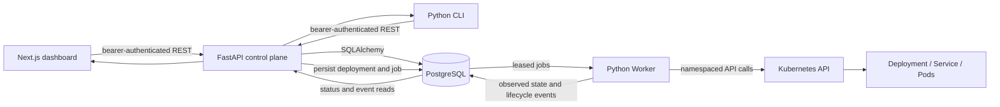

# MiniCloud Architecture

## Status

MiniCloud is an educational modular monolith with a separate polling worker.
It is not a production-ready public multi-tenant platform. See the
[current Resume MVP audit](../reports/MINICLOUD-RESUME-MVP-AUDIT.md) for
verified scope and blockers.

## End-to-end request flow



PostgreSQL is the durable job queue; no separate message broker is used.
`202 Accepted` records work, while only a current Kubernetes readiness
observation permits the Worker to mark a deployment `ready`. Historical
application E2E exists, but the current candidate has not passed E2E with a
dedicated namespace-scoped Worker identity.

The API owns authentication, project membership checks, validation, durable
deployment-job creation, and project-scoped reads. The worker claims jobs with
database leases, applies deterministic Kubernetes objects, and reports
observed readiness or a classified error. PostgreSQL stores projects,
memberships, deployments, jobs, lifecycle events, token revocations, and
transactional audit events.

Project and deployment list APIs use keyset cursors ordered by creation time
and UUID, with a maximum page size of 100. Composite indexes support those
ordered reads and user-to-project membership lookup; lifecycle events use the
same cursor ordering.

Scale requests require the replica count last observed by the caller. The API
locks the deployment row, checks that precondition, then persists one
idempotent scale operation; a stale count returns HTTP 409 instead of silently
overwriting a concurrent change. This concurrency guard currently covers scale
only, not every mutation path.

## Deployment lifecycle

```text
API accepted -> queued -> applying -> progressing -> ready
                                      |             |
                                      +-> timed_out +-> failed
```

`202 Accepted` means the request was persisted, not that Kubernetes is ready.
The worker only writes `ready` after observing the requested ready and
available replica count and the current desired generation. A timeout is
recoverable while observation continues.

## Data model and boundaries

Current SQLAlchemy entities are `User`, `Project`, `ProjectMembership`,
`AuditEvent`, `Deployment`, `DeploymentRevision`, `DeploymentJob`,
`DeploymentEvent`, and `TokenRevocation`. Idempotency keys are unique within a
project. New deployment, scale, and rollback jobs link to their accepted
revision; their lifecycle events persist the API-generated request ID, which
the Worker reuses in job-specific logs and events. Older records may have a
null request or revision ID. Kubernetes resource metadata does not currently
include request IDs.
Audit events
are inserted in the same transaction as successful project creation/name
updates, membership add/role/remove, deployment creation, and scale requests.
The PostgreSQL migration rejects audit row updates, deletes, and truncation;
the API role can insert only and the Worker has no audit-table access. There
is no public audit-read endpoint or retention/export workflow, and the ledger
does not yet cover Worker lifecycle transitions or failed authorization
attempts. Deployment revisions are append-only snapshots created on deployment
creation/scale and copied into a new revision for rollback. Existing
deployments receive one migration-time current-state snapshot; prior history
cannot be reconstructed. Rollback uses an expected-current-revision
precondition and a durable job, but live Kubernetes readiness remains
unverified. Project deletion/tombstones and per-project namespaces are not
implemented. Project resource policies are persisted and checked at API
admission; the dashboard shows them and allows owners to update them, but
their applied version remains pending because Kubernetes
Namespace/ResourceQuota/LimitRange reconciliation is not implemented.

The Kubernetes adapter reconciles Deployment and ClusterIP Service objects in
one configured namespace. Generated Pods have bounded CPU/memory, restricted
security settings, and service-account token automount disabled. The worker's
namespace Role does not include Secret access, delete, or cluster-wide access.
The required live least-privilege authorization proof remains blocked until an
isolated test cluster/RBAC operation is specifically approved.

## Runtime configuration

See [setup](SETUP.md), [deployment](DEPLOYMENT.md), [worker](WORKER.md), and
[Kubernetes](KUBERNETES.md). API, worker, and migration roles are configured
separately. Database schema changes are explicit Alembic migrations; the API
does not migrate the database at startup.

## Important omissions

There is no metrics provider, alert delivery, distributed rate limiter,
refresh-token rotation, browser cookie/CSRF session, request correlation
propagation into Kubernetes metadata, complete structured telemetry, project
quota controller, complete audit coverage, or namespace provisioner. Request
IDs now cross the API/database/Worker log and lifecycle-event boundary, but
this is not full end-to-end operation tracing.
The authenticated capability endpoint reports metrics and alerts as
unavailable. These are release gaps, not hidden implementation details.
