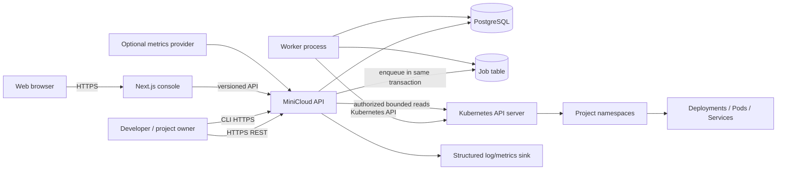
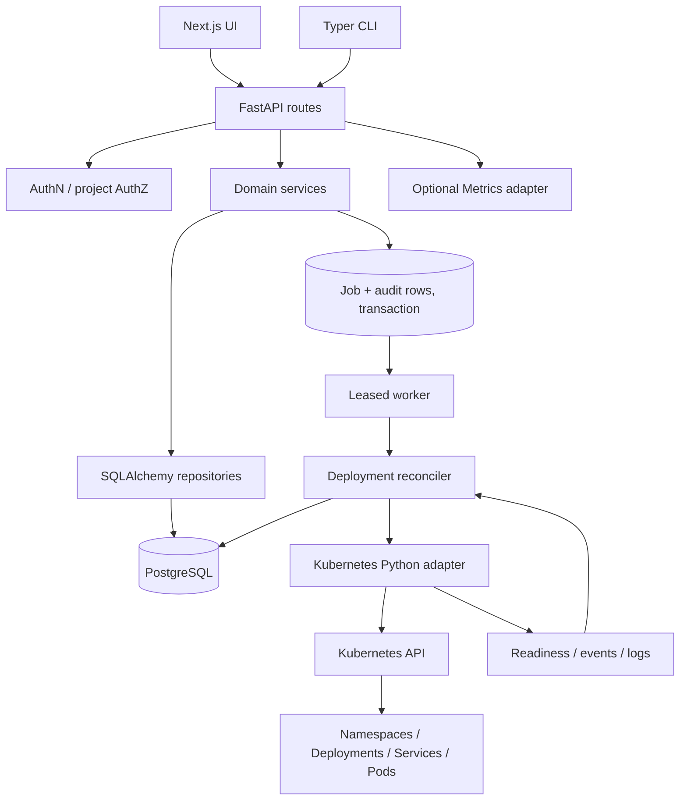
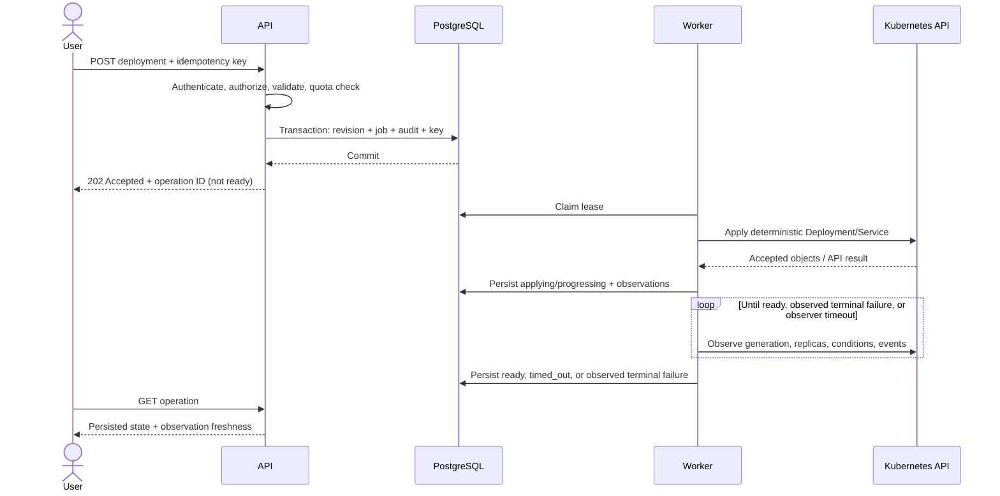
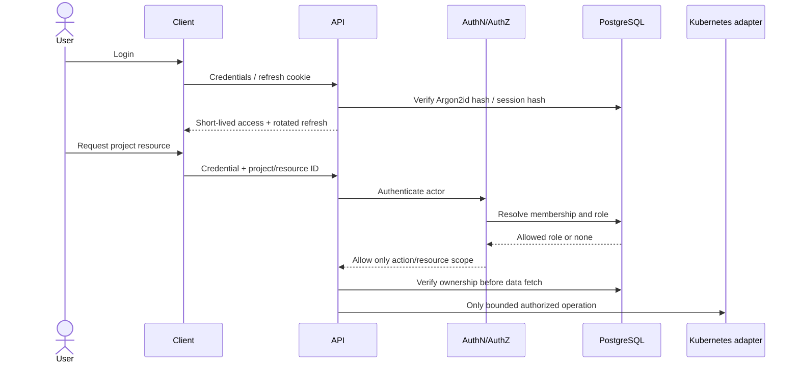
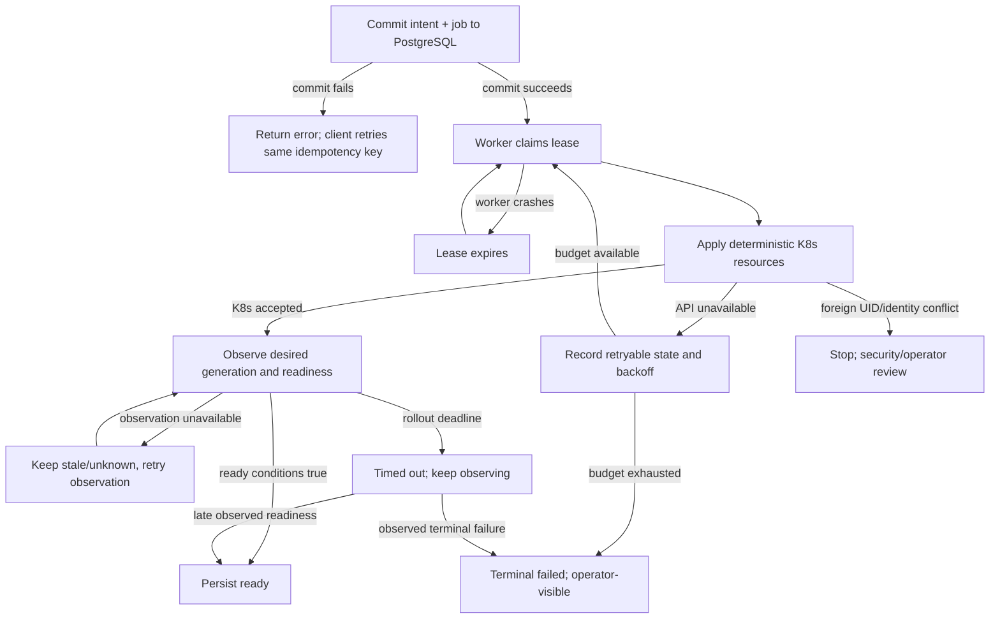
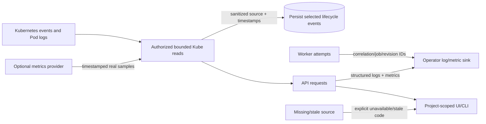

# 06 — System Architecture

**Status:** Proposed architecture, not deployed. The control plane starts as a
modular monolith; Kubernetes performs scheduling and workload reconciliation.

## System context



## Architecture choice and components

| Component | Responsibility / boundary |
| --- | --- |
| Web console | UX, form validation, operation polling; not authorization authority |
| CLI | Typed HTTP client, secure credential handling, readable/JSON output |
| API routes | HTTP schema, auth dependency, status/error mapping, request limits |
| AuthN/AuthZ | Identity/session validation and per-request project-role check |
| Project service | Project/membership/quota domain rules and transactional writes |
| Deployment service | Revision creation, idempotency, conflict/generation policy |
| Job worker | Durable claim/lease, bounded retries, operation deadlines |
| Kubernetes adapter | Typed allowlisted resource apply/read/log/event methods; no arbitrary manifest or shell |
| Reconciler | Compare durable desired revision with object identity/generation and observations |
| PostgreSQL | Durable desired metadata, jobs, revisions, audit and operational events |
| Kubernetes API server | Resource validation/storage and controller coordination |
| Deployment/Pod/Service | Actual workload scheduling, rollout and in-cluster discovery |
| Metrics adapter | Optional real provider, freshness/source metadata |
| Alert evaluator | SHOULD/future condition evaluation and tested notification delivery |

## Modular monolith versus microservices

The API, domain services, worker, reconciliation, and adapters share one
versioned codebase and domain contracts, but API and worker may run as separate
processes for isolation/concurrency. This avoids network services, message
broker, distributed auth/configuration, and operational overhead before
workload scale demands them. The trade-off is shared release cadence and
potential process resource contention. Extract a service only with measured
independent scaling/reliability need and an ADR.

## Component architecture



## Deployment sequence



## Authentication and authorization flow



## Rollback sequence

```mermaid
sequenceDiagram
  actor Owner
  participant API
  participant DB
  participant Worker
  participant K as Kubernetes API
  Owner->>API: POST rollback target revision + ETag/key
  API->>DB: Check role, target scope, generation
  API->>DB: Insert new revision (rollback_of), job, audit
  API-->>Owner: 202 + new operation ID
  Worker->>DB: Claim job
  Worker->>K: Apply copied supported configuration
  Worker->>K: Observe new generation/readiness
  Worker->>DB: Persist ready/failed; preserve old history
```

## Failure and recovery



## Observability data flow



## End-to-end lifecycle and state model

1. **Request:** bounded typed schema, request size and idempotency key.
2. **Authentication:** verify access/session and revocation/expiry.
3. **Authorization:** server-side role and exact resource/project scope.
4. **Validation:** supported image/config fields, quota, generation/ETag.
5. **Persistence:** one PostgreSQL transaction stores revision, job, audit,
   request hash/result. Only after commit return `202`.
6. **Background execution:** worker leases operation; lease is renewable and
   expires after crash; bounded attempts and wall-clock deadline.
7. **Kubernetes apply:** adapter uses deterministic object names and labels,
   checks namespace identity, applies an allowlisted desired object.
8. **Readiness:** observe Deployment generation/conditions and ready replicas;
   persist timestamp/source/resource UID. Readiness is not inferred from API
   object creation.
9. **Final status:** ready/failure persisted with reason/evidence; a deadline
   records `timed_out` without ending observation; stale status is shown if
   observation is unavailable.

### Legal operation transitions

Persisted state for a revision's operation:

```text
accepted -> queued -> applying -> progressing -> ready
    |          |          |            |
    +----------+----------+------------+----> failed
                         progressing -> timed_out -> ready
                                      |          |
                                      +----------+----> failed
```

`accepted` means DB transaction committed; `queued` means worker-visible;
`applying` means a worker began resource mutation; `progressing` means resources
exist but readiness is not verified; `ready` means the configured readiness
condition was observed for the desired generation. `timed_out` means MiniCloud's
readiness deadline elapsed without a terminal Kubernetes failure; it is
recoverable and remains eligible for observation. Later readiness transitions
to `ready` with a recovery event; observed terminal Kubernetes failure or an
irrecoverable identity conflict transitions to terminal `failed`. A deadline
alone does not assert that Kubernetes stopped or failed the workload. A later
attempt/redeploy/rollback creates a new revision and operation; only the
timed-out operation remains open for reconciliation.

Job execution fields (lease owner, attempt, lease expiry) are separate from
revision operation state. Kubernetes conditions/replica counts are **observed
facts**, timestamped snapshots; readiness status is a persisted conclusion
derived from those facts. Current deployment summary points to latest desired
revision, not an independent contradictory state machine. No transaction spans
PostgreSQL and Kubernetes.

### Implemented deployment revision path

The current API persists a desired-state snapshot with deployment creation and
each accepted scale. A rollback request supplies both the target revision ID
and the expected current revision ID; the API locks the deployment row, then
creates a new snapshot copied from the target, records
`rollback_of_revision_id`, links the durable job, and writes its event/audit
record in one transaction. The Worker consumes the resulting desired
Deployment fields through its normal apply-and-observe path; it does not need
read access to the revision table. Revision rows are append-only and the API
runtime role has only SELECT/INSERT privileges. Existing deployments are
backfilled with one snapshot of their current state; historical snapshots
before that migration cannot be reconstructed. This source/test coverage does
not verify successful Kubernetes rollback readiness.

## Trust, network, and failure boundaries

- Browser/CLI to API: TLS in external deployment; local development may use
  loopback HTTP only. Credentials never grant direct cluster access.
- API/worker to PostgreSQL: private Compose/container network; separate DB
  credentials, bounded pools.
- Worker/API to Kubernetes API: explicit kubeconfig/service account mounted
  only to processes needing access; TLS/auth; least-privilege RBAC.
- Kubernetes namespace is a resource grouping/isolation aid, **not by itself**
  a security boundary for hostile tenant code. Node, CNI, admission, runtime,
  secrets, and control-plane posture matter.
- Metrics/log sources are optional and can fail independently from desired
  deployment state. Their absence does not imply zero usage or healthy state.

## Retries, timeouts, idempotency, and concurrency

API validation/auth is synchronous with bounded DB timeout. Kube apply/observe
is asynchronous; initial proposed per-call timeout 5 seconds and per-operation
rollout deadline 10 minutes are provisional and must be tuned against kind.
Deadline expiry is a visible recoverable state, not evidence that Kubernetes
stopped the workload; the worker continues observation until readiness or an
observed terminal failure.
Transient errors retry with bounded exponential backoff + jitter (proposed
maximum 6 attempts) and deduplicated job identity. Idempotency key is unique
per actor/project/operation; same request returns same operation; body mismatch
returns 409. One active desired writer per deployment via DB compare-and-swap;
Kubernetes resource `resourceVersion` and generation are honored. Never blindly
retry non-idempotent side effects.

## Consistency and recovery

PostgreSQL stores desired intent and operation evidence; Kubernetes stores
actual resources and runtime observations. Commit intent/outbox/job atomically,
then reconcile desired state. A crash after apply but before DB update is
repaired by observing stable labels, UID, generation, and idempotent apply.
Foreign identity or manually changed configuration is surfaced as drift and
not adopted silently. Reconciliation must be safe after process restart.

## Scaling boundaries and deployment topology

MVP: one control-plane deployment with API and worker processes, PostgreSQL,
one operator-configured cluster. Processes can scale horizontally only after
lease/locking and DB pool limits are tested. Kubernetes scales application
Pods; MiniCloud does not schedule them. Database/job polling becomes first
capacity pressure; benchmark before adding a queue. Metrics/Prometheus/Grafana
are optional profiles.

## Resource constraints, security limits, evolution

Phase 0 reported 7.42 GiB physical host memory and Linux engine limit around
3.54 GiB; optional observability must remain off by default until measured.
MVP is educational/local, not production-HA. External TLS, secrets manager,
backup/restore, network policies, admission controls, stronger tenant boundary,
registry provenance, and incident response are required before production
claims. Evolution triggers are in [ADRs](../adr/README.md).
