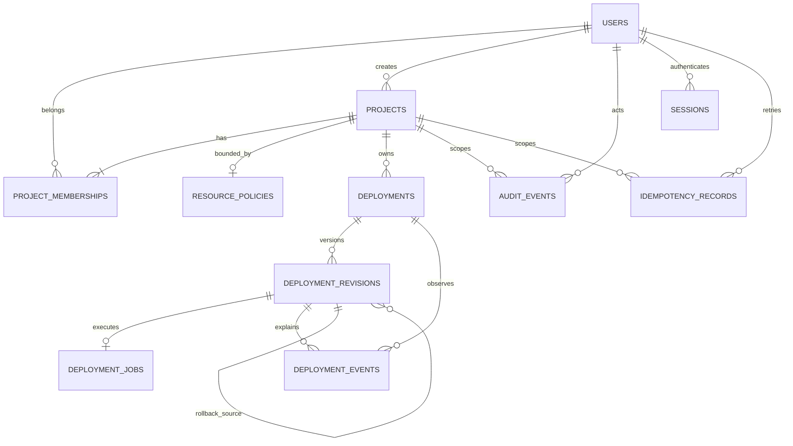

# 07 — Database Design

**Status:** Proposed PostgreSQL logical schema. No migrations or database were
created in Phase 1. Names and types must be confirmed in implementation.

## Data ownership and consistency

PostgreSQL is source of **desired control-plane metadata** and durable job state.
Kubernetes is source of actual workload objects and runtime observations.
`deployment_revisions` are immutable submitted configuration snapshots;
`deployment_jobs` represent execution/lease; `deployment_events` store selected
observations. They cannot commit atomically with Kubernetes. Reconciliation
uses project ID, deterministic names, labels, UID, and generation to recover.

## MVP entities

All timestamps are `timestamptz`, stored/compared in UTC. Use UUID primary keys
generated in application or PostgreSQL; do not embed secrets or credentials in
IDs. Text enum values have explicit application validation and DB constraints.

### `users`

| Field | Type | Null/default | Constraints / notes |
| --- | --- | --- | --- |
| `id` | UUID | not null | PK |
| `email_normalized` | citext or normalized text | not null | Unique; case normalization policy tested |
| `password_hash` | text | not null | Argon2id encoded hash/parameters only |
| `status` | text | not null, `active` | Check: active/disabled/pending |
| `created_at`, `updated_at` | timestamptz | not null, now() | UTC |

**Purpose/ownership:** account identity owned by auth module. Index unique email.
No password, session token, or recovery secret in audit payload. Deletion is
disable/anonymize only after project ownership transfer and retention policy.

### `projects`

`id UUID PK`; `slug text NOT NULL`; `name text NOT NULL`; `status text NOT NULL`
(provisioning/active/deleting/failed); `namespace_name text NOT NULL UNIQUE`;
`namespace_uid text NULL`; `created_by UUID FK users`; timestamps; `version
bigint NOT NULL DEFAULT 1`. Unique slug is global for MVP unless product decides
owner-scoped slug. `namespace_uid` binds against foreign namespace adoption.
Indexes `(status,created_at,id)` and creator. Project owner is expressed by
membership rather than creator field alone.

### `project_memberships`

`project_id UUID FK projects ON DELETE RESTRICT`; `user_id UUID FK users ON
DELETE RESTRICT`; `role text CHECK IN ('owner','member')`; `created_at`;
`created_by UUID FK users`; composite PK `(project_id,user_id)`. Index
`(user_id,project_id)` for authorized listing. Application and transaction
enforce at least one owner; use lock/serializable logic for concurrent owner
removal. Ownership checks apply before resource queries.

### `resource_policies`

`id UUID PK`; `project_id UUID FK projects UNIQUE`; `max_replicas integer
NOT NULL`; `cpu_request_millicores bigint NOT NULL`; `cpu_limit_millicores
bigint NOT NULL`; `memory_request_bytes bigint NOT NULL`; `memory_limit_bytes
bigint NOT NULL`; `updated_by_user_id UUID FK users`; `version integer`;
`applied_version integer NULL`; timestamps. Positive/check constraints
(`request <= limit`); platform maximum validated in service. New projects get
the default policy; legacy projects remain unconfigured until an owner
explicitly sets one. Kubernetes policy application is tracked separately and
remains pending until a reconciler updates `applied_version`. Never trust
Kubernetes quota as the only guard.

### `resource_policy_mutations`

`id UUID PK`; `project_id UUID FK projects`; `idempotency_key text`;
`request_hash text`; `policy_version integer`; `response json`; `created_at`.
Unique `(project_id,idempotency_key)` stores the original response for safe
replay of quota updates.

### `deployments`

Stable logical application: `id UUID PK`; `project_id UUID FK projects`;
`name text`; `namespace_name text`; `kubernetes_name text`; `kubernetes_uid
text NULL`; `desired_revision_id UUID NULL` (FK added after revisions);
`observed_generation bigint NULL`; `observed_replicas integer NULL`;
`readiness text CHECK IN ('unknown','pending','ready','failed','stale')`;
`last_observed_at timestamptz NULL`; `deleted_at timestamptz NULL`;
timestamps; `version bigint`. Unique `(project_id,name)` and
`(namespace_name,kubernetes_name)`; indexes by project and update time.
This row is a control-plane index, not proof of cluster object existence.

### `deployment_revisions`

Immutable desired snapshot: `id UUID PK`; `deployment_id UUID FK deployments`;
`revision_number integer`; `created_by UUID FK users`; `source text` (deploy,
scale, rollback); `rollback_of_revision_id UUID FK revisions NULL`;
`image_reference text`; `container_port integer`; `replicas integer`;
`resources jsonb`; `probe_config jsonb`; `non_secret_environment jsonb`;
`secret_references jsonb`; `config_hash text`; `state text` (accepted, queued,
applying, progressing, ready, failed); `failure_code text NULL`;
`failure_summary text NULL`; `observed_generation bigint NULL`;
`observed_ready_replicas integer NULL`; `observation_time timestamptz NULL`;
timestamps. Unique `(deployment_id,revision_number)`; indexes
`(deployment_id,created_at DESC,id DESC)`, `(state,updated_at)`. JSON snapshots
are schema-versioned and validated; secret values forbidden. Revision is
immutable except state/observation fields.

### `deployment_jobs`

`id UUID PK`; `revision_id UUID FK deployment_revisions UNIQUE` for one initial
operation/revision; `status text CHECK queued/leased/succeeded/failed`;
`attempt integer DEFAULT 0`; `available_at timestamptz`; `lease_owner text
NULL`; `lease_expires_at timestamptz NULL`; `last_error_code text NULL`;
`created_at`, `updated_at`, `completed_at NULL`. Index claim
`(status,available_at,created_at)`; index expired leases. Atomic claim by
`FOR UPDATE SKIP LOCKED` or equivalent. Lease holder is process identity, not
credential.

### `idempotency_records`

`id UUID PK`; `actor_id UUID FK users`; `project_id UUID FK projects`; `scope
text`; `key_hash text`; `request_hash text`; `operation_id UUID`; `response_code
integer`; `created_at`; `expires_at`; unique `(actor_id,project_id,scope,key_hash)`.
Hash key material before storage; don't log raw key. Retain at least operation
maximum retry window (proposed 24 h, open policy); same key/different hash =>409.

### `deployment_events`

`id UUID PK`; `deployment_id UUID FK deployments`; `revision_id UUID FK
deployment_revisions NULL`; `source text`; `event_type text`; `severity text`;
`message_redacted text`; `reason_code text NULL`; `kubernetes_uid text NULL`;
`observed_at timestamptz`; `created_at timestamptz`. Index
`(deployment_id,observed_at DESC,id DESC)`. Persist concise lifecycle evidence,
not unbounded container logs.

### `audit_events`

`id UUID PK`; `actor_id UUID NULL FK users`; `project_id UUID NULL FK projects`;
`action text`; `target_type text`; `target_id UUID NULL`; `outcome text`;
`request_id text`; `metadata_redacted jsonb`; `created_at timestamptz`.
Indexes by `(project_id,created_at DESC,id DESC)` and `(actor_id,created_at)`.
Append-only application DB role; separate restricted retention/administration.
Proposed retention 90 days local educational default is provisional and must be
validated against privacy/legal requirements.

## Deferred entities

- **`sessions`** is needed if opaque refresh rotation/server-side session
  revocation is chosen. Proposed fields: UUID, user FK, refresh-token hash,
  token-family UUID, created/expiry/last-used/revoked timestamps, client label
  redacted. Never store raw token. Required for proposed auth design.
- **`alert_rules` / `alert_events`:** SHOULD; add only when evaluator/delivery
  exists and can be tested.
- **Raw logs:** do not store in PostgreSQL MVP; retrieve bounded live Pod logs.
- **Outbox:** job row serves as transactional work queue. Add separate outbox
  only if non-job event consumers emerge.
- **Registry credentials:** defer secure external secret manager; never store
  plaintext credentials in application tables.

## ER diagram

## SQLAlchemy and migration considerations

Use SQLAlchemy 2 typed mappings, explicit `Mapped[]`/`mapped_column`, FK and
unique constraints in metadata, explicit relationships, and short transaction
scopes. Use JSONB only for validated schema-versioned configuration snapshots;
do not hide core queryable fields in JSON. Avoid implicit lazy DB queries in API
serialization. Use optimistic `version` checks and DB constraints as final
guard. Alembic migrations are reviewed, forward-compatible where possible,
tested from empty and previous schema, and never auto-downgrade production.

## Transactions and concurrency

Transaction for deployment acceptance: authorize from current membership,
check generation/quota, insert deployment if needed, revision, job,
idempotency record, audit event, update desired revision pointer, commit.
Respond accepted only after commit. Worker claims use short independent
transaction; no DB transaction remains open during Kubernetes network call.
After Kube response, persist observed operation in another transaction. Recovery
handles crash between those boundaries.

## Passwords, tokens, secrets, configuration

Argon2id encoded hash only; timing-safe verify and parameters rehash on login as
policy evolves. Session refresh token is random and stored hashed; rotate and
revoke family on replay. Browser gets HttpOnly/Secure/SameSite cookie, CSRF
defense; CLI credential storage uses OS keychain where available. MVP stores
non-secret environment only. Secret references identify operator-provisioned
Kubernetes Secret/key; MiniCloud never reads/displays secret value. Redaction
applies to event, audit metadata, log output, and API errors. Config snapshot
stores only explicit supported fields and schema version.

## Pagination, retention, backup, deletion

Cursor pagination ordered `(created_at,id)` descending; opaque cursor includes
filter scope and signature/validation. Hard cap proposed 100 per page. Audit
retention is open; local default proposal 90 days, with immutable export or
operator policy before production. Deployment events use a documented TTL or
bounded retention policy; Kubernetes logs are live-only in MVP.

PostgreSQL backup/restore is an operator responsibility and must be exercised
in a disposable environment before any reliability claim. Protect backups with
encryption/access controls, avoid copying production data to local tests.
Project delete tombstones first; worker removes only Kubernetes objects bearing
matching project identity; completion requires observed cleanup. Failed cleanup
remains retryable. User delete requires transfer/revoke/retention review.

## Kubernetes object relationship

Project namespace stores project label and namespace UID; deployment resources
carry project/deployment/revision labels and stable names. Database IDs map to
these labels plus recorded Kube UID, not to user-controlled names alone. A
matching deterministic name with wrong project label/UID is a conflict. A DB
row cannot assert object readiness; observations include generation/time and
are marked stale when source is unavailable. See [architecture](06-architecture.md).
